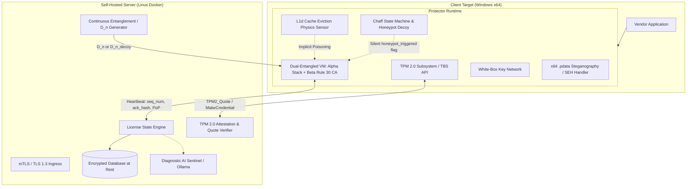

# Event Horizon (Spec v12 FOSS Ultimate)

> Hardware-Bound Licensing, Attestation Engine & Heterogeneous Binary Protector

Event Horizon is a self-hosted, Kerckhoffs-compliant licensing, hardware attestation, and binary protection framework. It prevents scalable unauthorized distribution of proprietary software by anchoring identity to cryptographic coprocessors (TPM 2.0) and defeating automated deobfuscation (Z3, Triton, angr, SiMBA) via an 8-layer heterogeneous transformation pipeline based on microarchitectural CPU physics and non-associative algebra.

---

## Target Platforms and Scope

| Component | Platform | Language / Toolchain | Rationale |
| :--- | :--- | :--- | :--- |
| **Client Runtime** | Windows x86_64 only | C++20 / Clang / MSVC | Interacts directly with Windows TBS (`tbs.dll`), CNG, and x64 SEH (`.pdata` / `UNWIND_INFO`). |
| **License & Attestation Server** | Linux (Primary), Windows, macOS | Go 1.22+ | Zero Windows-specific dependencies; deployable via containerized Docker environments. |
| **Admin Control Plane** | Cross-platform | Go 1.22+ / HTML5 | Protected via mTLS (with CRL checking) or short-lived WebAuthn sessions. |
| **Builder & LLVM Toolchain** | Cross-platform | C++20 (LLVM 18+), Go 1.22+ | Compiles and lifts targets, synthesizes White-Box tables, generates signed deploy bundles. |

---

## System Architecture



---

## 8 Heterogeneous Protection Layers (Section 2.11)

Standard packers and obfuscators rely on single-paradigm transformations (e.g., single VM dispatchers or linear mixed boolean-arithmetic) that are trivially bypassed by automated symbolic execution or bit-vector solvers. Event Horizon combines eight orthogonal mathematical and microarchitectural layers:

1. **Dual-Entangled Cellular Automata VM**: Two asynchronous engines (`VM_Alpha` stack machine and `VM_Beta` 1D Rule 30/110 cellular automaton) execute concurrently. The instruction pointer of Alpha is derived on each cycle from the chaotic cellular state of Beta and Alpha's accumulator:
   $$VIP_\alpha^{(t+1)} = VIP_\alpha^{(t)} \oplus \text{Rule30}(State_\beta^{(t)}) \oplus \text{ROTL}_{13}(Acc_\alpha^{(t)})$$
2. **Non-Associative Quasigroup MBA**: Arithmetic and bitwise operations are mapped into order-256 Latin squares generated via isotopic S-box bijections:
   $$x \ast y = P(S_1(x) \boxplus S_2(y)) \quad \text{where } (x \ast y) \ast z \neq x \ast (y \ast z)$$
   Because the algebra lacks associativity, commutativity, and distributivity, expression simplification in Z3, GAMBA, and SiMBA fails to factor expression trees.
3. **White-Box Key Dissolving (WBACR)**: AES/ChaCha encryption keys are converted into networks of precomputed lookup tables with non-linear input/output bijections ($T_i(x) = G_i \circ E_{k_i} \circ F_{i-1}^{-1}(x)$). Raw 256-bit keys are never assembled contiguously in RAM.
4. **x64 `.pdata` / `UNWIND_INFO` Control Flow Steganography**: Algorithms are partitioned into code islands linked by deliberate architectural traps (division by dynamic zero or non-canonical memory reads). Dispatcher addresses are stored in standard `.pdata` language-specific exception handler records. If external debugger hooks are detected, the exception handler redirects execution to mirage functions.
5. **Hardware Cache-Line & TLB Eviction Physics**: Measures access latency over 8 cache lines (512 bytes) using serializing fences (`lfence; rdtsc`). Debugger single-stepping, context switching to x64dbg, or hypervisor VM-Exits evict L1d cache lines into DRAM (>150 cycles vs 4-5 cycles). The eviction bit directly alters the state accumulator through quasigroup multiplication without conditional branches.
6. **Chaff State Machines & Honeypot Decoy Execution**: Incorporates `.text` opcode bytes into address calculations (self-checksumming code-as-key). If modified by an `0xCC` software breakpoint or cache eviction, execution transitions into a decoy state machine: returns `STATUS_SUCCESS`, renders functional UI, but outputs subtly corrupted data and embeds a silent `honeypot_decoy_triggered = 1` flag into heartbeat telemetry.
7. **Symbolic Path Explosion & Taint Sinks**: 64-iteration state-dependent branching loops with memory-indirect indexing generate $2^{64}$ execution paths, exhausting memory (OOM) in angr, Triton, and KLEE.
8. **Continuous Server-Client Data Entanglement**: Cellular automaton transition rules and Latin square diagonals are omitted from the client binary. They are provided dynamically on each `/heartbeat` in epoch matrices ($D_n$). When honeypot activation is detected, the server serves mathematically plausible decoy matrices ($D_{n,\text{decoy}}$).

---

## Repository Layout

```
.
├── client/                 # Windows x64 C++20 Protector & Runtime
│   ├── include/            # Public headers (SDK, VM, TPM interfaces)
│   └── src/
│       ├── tpm/            # TBS API, TPM 2.0 Quote, Make/ActivateCredential
│       ├── session/        # Ephemeral PoP key generation, TLS 1.3, Heartbeat
│       ├── vm/             # Dual VM, Cache sensor, Chaff machine, .pdata SEH
│       └── sdk/            # Path A loader (restricted ACL, POSIX unlink)
├── llvm-passes/            # LLVM 18+ Transformation Toolchain
│   ├── include/            # Pass headers
│   └── src/                # Quasigroup MBA, Symbolic Explosion, DualVM, .pdata passes
├── server/                 # Go 1.22+ License & Attestation Backend
│   ├── cmd/server/         # Main server entrypoint
│   └── internal/
│       ├── licensing/      # License lifecycle state machine & endpoints
│       ├── admin/          # mTLS Control plane & audit trails
│       ├── telemetry/      # Ollama LLM post-mortem incident analyzer
│       └── storage/        # Encrypted SQLite / SQLCipher at rest
├── shared/                 # Protocol Buffers, Cryptographic Primitives, TPM specs
├── builder/                # Binary packaging tool (Paths A, A+, B)
├── deploy/                 # Docker Compose, Key rotation, and backup automation
├── tests/                  # Cross-component unit and integration tests
├── THREAT_MODEL.md         # Comprehensive security specification & proof analysis
└── README.md
```

---

## Packaging Modes (Section 2.10)

1. **Path A (SDK / DLL Integration — Recommended)**:
   Source code is compiled through the heterogeneous LLVM pipeline into a signed DLL. At runtime, the client decrypts the payload into a temporary file protected by a restricted security descriptor (current process token only), loads it via `LoadLibraryW` to create a standard `MEM_IMAGE` section, and unlinks it immediately via `SetFileInformationByHandle` using `FileDispositionInfoEx` with `FILE_DISPOSITION_POSIX_SEMANTICS`.
2. **Path A+ (Binary Lifting & Heterogeneous Recompilation)**:
   Pre-compiled vendor x86_64 PE binaries are lifted to LLVM IR, passed through the 8-layer obfuscation pipeline, and recompiled into clean, native PE binaries with signed `.text` sections and modified `.pdata` tables.
3. **Path B (Reflective PE Loader — Legacy Fallback)**:
   Raw in-memory mapping (`MEM_PRIVATE` with `PAGE_EXECUTE_READWRITE`). Explicitly flagged in UI and logs due to higher susceptibility to EDR behavioral heuristics.

---

## Quick Start (Development)

### Prerequisites
- Windows 10/11 x64 (for Client runtime testing)
- LLVM / Clang 18+
- Go 1.22+
- Docker & Docker Compose (for server deployment)
- TPM 2.0 physical chip (or `swtpm` for development builds)

### Server Build & Run
```bash
cd server
go build -o ../bin/license-server ./cmd/server
./bin/license-server --config ../deploy/server-config.yaml
```

### Client Runtime Build
```bash
cd client
cmake -B build -G "Ninja" -DCMAKE_BUILD_TYPE=Release
cmake --build build --target event_horizon_client
```
