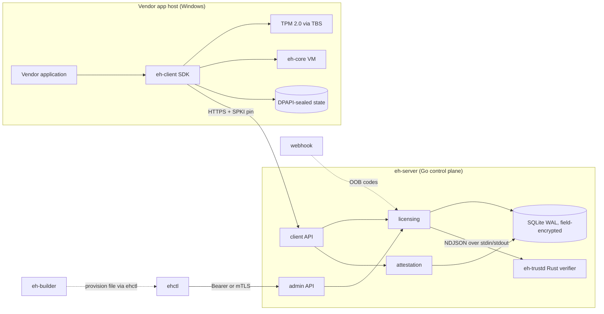

# Event Horizon — Architecture

## 1. What this is

A self-hosted software licensing and hardware-attestation system for Windows
applications. One server binary, one optional trust daemon, one operations CLI,
one vendor-side builder, one client SDK. The client side is deliberately small
and honest about what software protection can and cannot do (see
`THREAT_MODEL.md`).

## 2. Goals and non-goals

**Goals**

- Real security properties, verifiable end to end: TLS everywhere, TPM 2.0
  attestation, monotonic anti-replay heartbeats, revocation that actually
  revokes.
- Privacy by construction: no telemetry, no third-party services, no
  phone-home beyond the operator's own server.
- Operational simplicity: a single static server binary plus SQLite file;
  everything runs on one small box.
- Extensibility with documented seams: modules with hard boundaries, ready to
  be split out when scale or compliance demands it.

**Non-goals**

- Perfect client-side protection. Any local code can be reverse engineered by
  a determined attacker; the system's job is to make piracy economically
  pointless and detectable, not impossible.
- Multi-region horizontal scale. Single-node by design; the Postgres seam is
  documented (§10).
- A web admin UI. v2 ships an API plus a CLI (`ehctl`).

## 3. Components



## 4. Repository layout

The server is a modular monolith: one process, one SQLite file, explicit
package boundaries. Files are split by feature, not by technical layer alone,
so a change has one obvious home.

```
.
