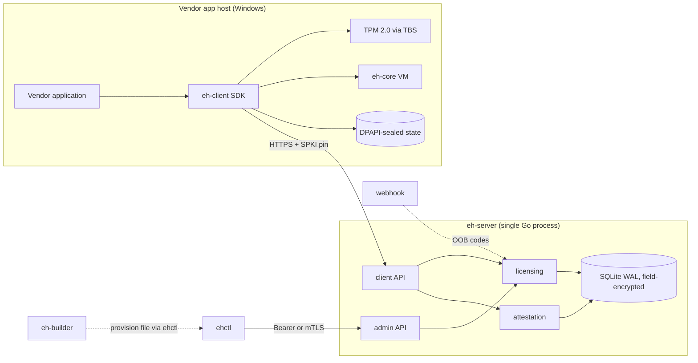

# Event Horizon — Architecture

## 1. What this is

A self-hosted software licensing and hardware-attestation system for Windows
applications. One server binary, one operations CLI, one vendor-side builder,
one client SDK. The client side is deliberately small and honest about what
software protection can and cannot do (see `THREAT_MODEL.md`).

## 2. Goals and non-goals

**Goals**

- Real security properties, verifiable end to end: TLS everywhere, TPM 2.0
  attestation, monotonic anti-replay heartbeats, revocation that actually
  revokes.
- Privacy by construction: no telemetry, no third-party services, no
  phone-home beyond the operator's own server.
- Operational simplicity: a single static server binary plus SQLite file;
  everything runs on one small box.
- Extensibility with documented seams: modules with hard boundaries, ready to
  be split out when scale or compliance demands it.

**Non-goals**

- Perfect client-side protection. Any local code can be reverse engineered by
  a determined attacker; the system's job is to make piracy economically
  pointless and detectable, not impossible.
- Multi-region horizontal scale. Single-node by design; the Postgres seam is
  documented (§10).
- A web admin UI. v2 ships an API plus a CLI (`ehctl`).

## 3. Components



## 4. Repository layout

```
.
├── cmd/
│   ├── eh-server/      # license & attestation server
│   ├── ehctl/          # operations CLI (PKI, licenses, packages, backup, audit)
│   └── eh-builder/     # vendor packaging tool
├── internal/
│   ├── wire/           # JSON DTOs, error codes, validation helpers
│   ├── cryptox/        # HKDF, AEAD, HMAC, Ed25519/X25519 helpers, license key codec
│   ├── config/         # YAML + env configuration, defaults, validation
│   ├── store/          # the only package that runs SQL: migrations + typed methods
│   ├── licensing/      # license/device/session state machines, clone policy
│   ├── attestation/    # TPM2 quote verification, MakeCredential
│   ├── notify/         # OOB delivery: webhook + manual
│   ├── ratelimit/      # token buckets keyed per IP/entity with GC
│   ├── api/            # HTTP transport: routing, middleware, TLS, handlers
│   └── packaging/      # .ehpkg container + provision files
├── rust/
│   ├── eh-core/        # the EHVM1 bytecode machine (docs/VM.md)
│   └── eh-client/      # Windows SDK: TBS/TPM2, ureq+rustls, DPAPI state, sessions, C ABI, demo
├── deploy/             # Dockerfile, compose, systemd, example configs
└── docs/               # architecture, protocol, threat model, operations, decisions
```

## 5. Module responsibilities

| Module | Responsibility | Must not |
|---|---|---|
| `internal/wire` | DTOs and validation of every field crossing the boundary | contain business logic |
| `internal/cryptox` | primitives and key derivation with fixed info strings | store keys |
| `internal/store` | SQL, migrations, field-level encryption, transactions | implement policy |
| `internal/licensing` | state machines, quotas, clone policy, heartbeats | speak HTTP |
| `internal/attestation` | TPM structure parsing, signature verification, credential construction | touch the DB |
| `internal/api` | routing, middleware, TLS, JSON error mapping | implement domain rules |
| `cmd/*` | flag parsing, wiring, process lifecycle | contain reusable logic |

## 6. Runtime model

- **Server**: one process. `net/http` with explicit timeouts; graceful
  shutdown on SIGINT/SIGTERM; two background janitors (nonce expiry,
  rate-limiter GC); structured logs (`slog` JSON) to stdout; no external
  daemons.
- **Client**: a library crate with a synchronous API. All private keys live
  in process memory only. The caller drives heartbeats or uses the built-in
  loop. Local session state (keys, lease deadlines, the unwrapped package
  key) is sealed with DPAPI and written atomically; HTTPS runs on ureq with
  rustls (ring provider) plus optional SPKI pinning. Payload bytecode runs on
  `eh-core` with the session `vm_seed`.
- **C ABI**: `eh_client_new` returns an opaque, caller-owned pointer freed
  with `eh_client_free`. String and payload pointers returned by the library
  are borrowed: they are valid only until the next call on the same handle or
  `eh_client_free`, whichever comes first. Copy anything that must outlive
  the call; never free a returned pointer.
- **ehctl / eh-builder**: one-shot CLIs, no daemons, no config files beyond
  flags and environment.

## 7. Data model

SQLite (WAL) with these tables: `meta`, `licenses`, `devices`, `oob_codes`,
`sessions`, `nonces`, `packages`, `admin_tokens`, `audits`.

Encryption policy:

- License keys: HMAC-SHA256 only (`eh/license-hmac/v1` subkey).
- Secrets at rest (OOB codes, package keys, session secrets, OOB channel):
  AES-256-GCM per field with `eh/field/v1` subkey; nonce prepended.
- Everything else (statuses, timestamps, audit trail) is plaintext by design —
  it is operational data, not secrets.
- Master key: 32 bytes from `EH_MASTER_KEY` (hex) or a 0600 key file;
  subkeys via HKDF-SHA256 with fixed info strings.

## 8. Trust boundaries

| Zone | Trust | Controls |
|---|---|---|
| Network | hostile | TLS 1.2+, optional SPKI pin, request caps, rate limits |
| Client machine | untrusted | nothing believed without TPM proof; fingerprint is a hint |
| Admin plane | strong auth | argon2id bearer tokens and/or mTLS; every action audited |
| Provision files | operator secret | gitignored, imported once, stored encrypted |
| Database file | semi-trusted | field encryption; HMACs for lookup keys |

## 9. Failure modes

- **Server unreachable**: the client keeps running until
  `lease_exp + offline_grace_s` (both server-provided), then it must reach
  the server again; established sessions survive restarts from the sealed
  state file.
- **Attestation unavailable**: `mode: auto` downgrades trust and audits;
  `mode: required` rejects the request.
- **Webhook delivery fails**: the code stays retrievable via
  `ehctl licenses oob show` (audited) — manual path always works.
- **Disk/DB errors**: surfaced as 500s and logged; nothing is swallowed
  (the v1 lesson).
- **Client clock tampering**: the offline window is enforced client-side and
  is therefore advisory — an attacker who controls the machine can extend it,
  as with any local check. The server is the authority whenever it is
  reachable: heartbeats are monotonic (`seq`/ack chain) and leases expire.

## 10. Evolution path (seams)

The layout keeps these splits cheap, and we deliberately did **not** take
them in v2:

1. `internal/attestation` → its own service when enterprise PCR policies or
   HSM-backed EK trust are needed.
2. Admin plane → separate listener/deployment when network policy separates
   ops from client traffic.
3. `internal/store` → Postgres when a single node is no longer enough
   (module boundary already isolates SQL).
4. `eh-builder` → CI service mode.

Why not microservices now: for a single-tenant licensing server, network
splits buy nothing and cost deployment complexity, partial-failure modes and
debugging pain. The modules above are the honest seams; splitting them is a
configuration change, not a rewrite.

## 11. Quality attributes

- **Privacy**: zero telemetry; the only egress is webhook OOB delivery if the
  operator configures it.
- **Supply chain**: small dependency sets — `google/go-tpm`, `x/crypto`,
  `modernc.org/sqlite` on the server; RustCrypto crates, `ureq`, `rustls`,
  `webpki-roots` and `windows-sys` on the client. No cgo.
- **Performance envelope**: SQLite WAL comfortably handles tens of thousands
  of licenses and 15-minute heartbeats on one core; `/verify` is
  cryptography-bound (Ed25519/RSA verify, no per-request keygen).
- **Portability**: server builds for linux/darwin/windows; client targets
  `x86_64-pc-windows-gnu` (MSVC also supported).
