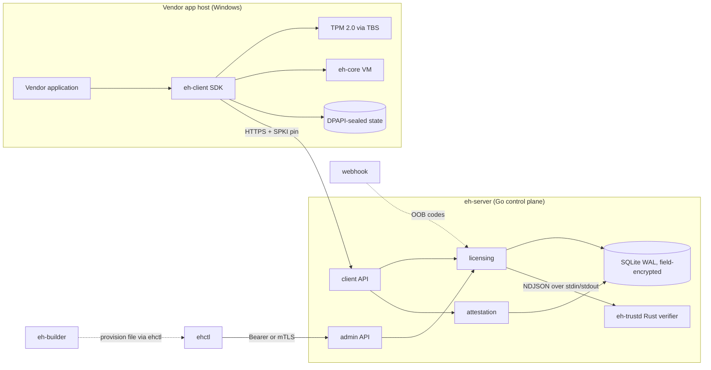

# Event Horizon — Architecture

## 1. What this is

A self-hosted software licensing and hardware-attestation system for Windows
applications. One server binary, one optional trust daemon, one operations CLI,
one vendor-side builder, one client SDK. The client side is deliberately small
and honest about what software protection can and cannot do (see
`THREAT_MODEL.md`).

## 2. Goals and non-goals

**Goals**

- Real security properties, verifiable end to end: TLS everywhere, TPM 2.0
  attestation, monotonic anti-replay heartbeats, revocation that actually
  revokes.
- Privacy by construction: no telemetry, no third-party services, no
  phone-home beyond the operator's own server.
- Operational simplicity: a single static server binary plus SQLite file;
  everything runs on one small box.
- Extensibility with documented seams: modules with hard boundaries, ready to
  be split out when scale or compliance demands it.

**Non-goals**

- Perfect client-side protection. Any local code can be reverse engineered by
  a determined attacker; the system's job is to make piracy economically
  pointless and detectable, not impossible.
- Multi-region horizontal scale. Single-node by design; the Postgres seam is
  documented (§10).
- A web admin UI. v2 ships an API plus a CLI (`ehctl`).

## 3. Components



## 4. Repository layout

The server is a modular monolith: one process, one SQLite file, explicit
package boundaries. Files are split by feature, not by technical layer alone,
so a change has one obvious home.

```
.
├── cmd/
│   ├── eh-server/      # main.go, run.go, bootstrap.go, healthcheck.go, tls.go
│   ├── ehctl/          # one file per command group: init, license, device, packages, audits, tokens, backup
│   └── eh-builder/     # vendor packaging tool
├── internal/
│   ├── wire/           # JSON DTOs, error codes, validation helpers
│   ├── cryptox/        # HKDF, AEAD, HMAC, Ed25519/X25519 helpers, license key codec
│   ├── config/         # YAML + env configuration, defaults, validation
│   ├── store/          # SQL by aggregate: store, licenses, devices, oob, sessions, nonces, packages, tokens, audits, backup
│   ├── licensing/      # workflows: service, activate, oob, reset, challenge, verify, heartbeat, janitor, admin files
│   ├── attestation/    # TPM2 quote verification, MakeCredential
│   ├── notify/         # OOB delivery: webhook + manual
│   ├── ratelimit/      # token buckets keyed per IP/entity with GC
│   ├── api/            # transport: server, routes, middleware, auth, decode, respond, health; client_* and admin_* handlers
│   ├── trustd/         # client for the isolated Rust TPM verifier
│   ├── platform/reqid/ # request correlation IDs and middleware
│   └── packaging/      # .ehpkg container + provision files
├── rust/
│   ├── eh-core/        # the EHVM1 bytecode machine (docs/VM.md)
│   ├── eh-trustd/      # isolated TPM quote verifier; tpm/{reader,public,attest,signature,constants}.rs
│   └── eh-client/      # Windows SDK: TBS/TPM2, ureq+rustls, DPAPI state, sessions, C ABI, demo
├── deploy/             # Dockerfile, compose, systemd, example configs
└── docs/               # architecture, protocol, threat model, operations, decisions
```

## 5. Module responsibilities

| Module | Responsibility | Must not |
|---|---|---|
| `internal/wire` | DTOs and validation of every field crossing the boundary | contain business logic |
| `internal/cryptox` | primitives and key derivation with fixed info strings | store keys |
| `internal/store` | SQL, migrations, field-level encryption, transactions; one file per aggregate | implement policy |
| `internal/licensing` | state machines, quotas, clone policy, heartbeats; one file per workflow | speak HTTP |
| `internal/attestation` | TPM structure parsing, signature verification, credential construction | touch the DB |
| `internal/trustd` | spawn and talk to `eh-trustd`, map its results to domain types | parse TPM structures itself |
| `rust/eh-trustd` | parse untrusted TPM data and verify signatures in an isolated process | touch the DB, network or keys |
| `internal/api` | routing, middleware, JSON error mapping; one file per transport concern | implement domain rules |
| `internal/platform/reqid` | request IDs, response header, context propagation | know about licensing |
| `cmd/*` | flag parsing, wiring, process lifecycle | contain reusable logic |

## 6. Runtime model

- **Server**: one process. `net/http` with explicit timeouts; graceful
  shutdown on SIGINT/SIGTERM; background janitor for nonce expiry and stale
  OOB rows, plus rate-limiter GC. JSON logs (`slog`) go to stderr; no network
  daemons. When `attestation.trustd_path` is set, `eh-server` spawns
  `eh-trustd`, a stateless verifier that reads one JSON request per line on
  stdin and writes one JSON response per line on stdout. Every response
  carries the internal protocol version; a mismatch fails closed. The child
  has no sockets, no DB handle and no keys; it starts with an empty environment
  and runs as the same service user, so this isolates the untrusted parse path
  but is not a kernel sandbox. A crash or timeout kills and respawns it, and
  the request fails closed.
- **Request correlation**: every HTTP request gets an `X-Request-ID`. A
  client-supplied ID is kept only if it is 8–64 characters from
  `[A-Za-z0-9._-]`; otherwise the server generates one. The ID is echoed in
  the response header and in every JSON error body (`request_id`). A 5xx log
  line contains the same ID, the method, the path, the error chain and the
  handler stack. Operators can search by one ID instead of guessing a source
  file.
- **Readiness**: `GET /api/v1/health` is liveness. `GET /api/v1/ready` checks
  the database and reports the configured attestation backend. A trustd
  outage does not fail readiness: admin, heartbeat and already-issued sessions
  keep working; only new quote/activation work fails closed.
- **Client**: a library crate with a synchronous API. All private keys live
  in process memory only. The caller drives heartbeats or uses the built-in
  loop. Local session state (keys, lease deadlines, the unwrapped package
  key) is sealed with DPAPI and written atomically; HTTPS runs on ureq with
  rustls (ring provider) plus optional SPKI pinning. Payload bytecode runs on
  `eh-core` with the session `vm_seed`.
- **C ABI**: `eh_client_new` returns an opaque, caller-owned pointer freed
  with `eh_client_free`. String and payload pointers returned by the library
  are borrowed: they are valid only until the next call on the same handle or
  `eh_client_free`, whichever comes first. Copy anything that must outlive
  the call; never free a returned pointer.
- **ehctl / eh-builder**: one-shot CLIs, no daemons, no config files beyond
  flags and environment.

## 7. Data model

SQLite (WAL) with these tables: `meta`, `licenses`, `devices`, `oob_codes`,
`sessions`, `nonces`, `packages`, `admin_tokens`, `audits`.

Encryption policy:

- License keys: HMAC-SHA256 only (`eh/license-hmac/v1` subkey).
- Secrets at rest (OOB codes, package keys, session secrets, OOB channel):
  AES-256-GCM per field with `eh/field/v1` subkey; nonce prepended.
- Everything else (statuses, timestamps, audit trail) is plaintext by design —
  it is operational data, not secrets.
- Master key: 32 bytes from `EH_MASTER_KEY` (hex) or a 0600 key file;
  subkeys via HKDF-SHA256 with fixed info strings.

## 8. Trust boundaries

| Zone | Trust | Controls |
|---|---|---|
| Network | hostile | TLS 1.2+, optional SPKI pin, request caps, rate limits |
| Client machine | untrusted | nothing believed without TPM proof; fingerprint is a hint |
| Admin plane | strong auth | argon2id bearer tokens and/or mTLS with a certificate-CN allowlist; every action audited |
| Provision files | operator secret | gitignored, imported once, stored encrypted |
| Database file | semi-trusted | field encryption; HMACs for lookup keys |

## 9. Failure modes

The process has one hard dependency (the database) and several optional ones.
A failure is contained at the narrowest boundary that can still serve a useful
answer.

| Failure | Impact | Recovery |
|---|---|---|
| SQLite unavailable or corrupt | All endpoints fail and readiness returns 503; there is no safe read-only mode | restore the DB, restart, inspect the readiness log |
| `eh-trustd` exits or times out | New quote/activation requests fail closed; already-issued sessions, heartbeats, admin and CLI keep working | client restarts on the next request; readiness still reports `trustd` as the configured backend |
| Webhook delivery fails | The OOB code stays in the DB; activation still returns `oob_required`; delivery failure is audited | admin reveals the code with `ehctl license oob` (audited) |
| Janitor SQL error or panic | Cleanup is delayed; API traffic is unaffected; the panic is logged and the loop continues | inspect the log; no restart required for a transient error |
| Rate-limiter GC failure | Old buckets linger; requests still work | restart only if memory growth is observed |

- **Server unreachable**: the client keeps running until
  `lease_exp + offline_grace_s` (both server-provided), then it must reach
  the server again; established sessions survive restarts from the sealed
  state file.
- **Attestation unavailable**: `mode: auto` downgrades trust and audits;
  `mode: required` rejects the request.
- **Disk/DB errors**: surfaced as 500s and logged; nothing is swallowed
  (the v1 lesson). The response carries the request ID and the log line
  carries the stack.
- **Client clock tampering**: the offline window is enforced client-side and
  is therefore advisory — an attacker who controls the machine can extend it,
  as with any local check. The server is the authority whenever it is
  reachable: heartbeats are monotonic (`seq`/ack chain) and leases expire.

## 10. Evolution path (seams)

The layout keeps these splits cheap, and we deliberately did **not** take
them in v2:

1. `internal/attestation` → fully separate service when enterprise PCR policies
   or HSM-backed EK trust are needed. Quote and AK verification already run in
   the isolated Rust `eh-trustd`; TPM credential activation remains embedded
   until its input path is split too.
2. Admin plane → separate listener/deployment when network policy separates
   ops from client traffic.
3. `internal/store` → Postgres when a single node is no longer enough
   (module boundary already isolates SQL).
4. `eh-builder` → CI service mode.

Why not microservices now: for a single-tenant licensing server, network
splits buy nothing and cost deployment complexity, partial-failure modes and
debugging pain. The modules above are the honest seams; extracting one later
is a bounded refactor with a stable interface, not a rewrite.

## 11. Where to change what

| Change | Start here |
|---|---|
| Add or change an HTTP route | `internal/api/routes.go`, then `client_*.go` or `admin_*.go` |
| Change request/response fields | `internal/wire/client.go` or `admin.go` |
| Change activation, OOB, reset, verify or heartbeat policy | the matching file in `internal/licensing/` |
| Change SQL or a transaction | the matching aggregate file in `internal/store/` |
| Change a schema | `internal/store/migrations.go` plus the aggregate file |
| Add an audit action | `internal/store/audits.go` and the caller |
| Change a config key or default | `internal/config/config.go`, then docs and `deploy/` |
| Change a TPM parser or signature policy | `rust/eh-trustd/src/tpm/` and `verify.rs` |
| Change request IDs or error envelopes | `internal/platform/reqid/` and `internal/api/respond.go` |
| Change CLI output | the matching file in `cmd/ehctl/` |

## 12. Quality attributes

- **Privacy**: zero telemetry; the only egress is webhook OOB delivery if the
  operator configures it.
- **Supply chain**: small dependency sets — `google/go-tpm`, `x/crypto`,
  `modernc.org/sqlite` on the server; RustCrypto crates, `ring`, `ureq`,
  `rustls`, `webpki-roots` and `windows-sys` on the Rust side. No cgo.
- **Performance envelope**: SQLite WAL comfortably handles tens of thousands
  of licenses and 15-minute heartbeats on one core; `/verify` is
  cryptography-bound (Ed25519/RSA verify, no per-request keygen).
- **Portability**: server builds for linux/darwin/windows; client targets
  `x86_64-pc-windows-gnu` (MSVC also supported).
